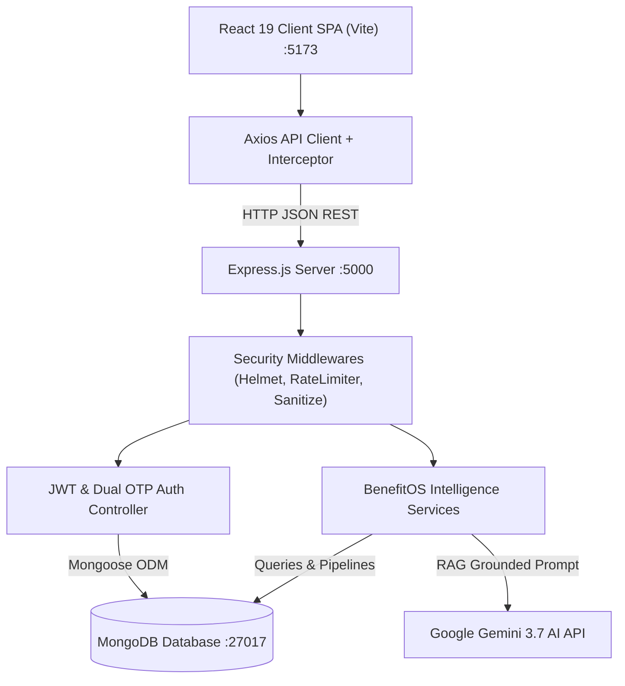

# 🏛️ BenefitOS System Architecture Specification

## 1. High-Level Architectural Pattern
BenefitOS follows a decoupled **Full-Stack MERN Architecture** adhering to clean API boundaries and separation of concerns:

- **Client Tier**: React 19 Single-Page Application (SPA) bundled with Vite. State managed with React Context (`AuthContext`, `LanguageContext`), styling via Vanilla CSS custom properties (Design Tokens) and Framer Motion.
- **API Tier**: Node.js v20+ with Express 5 RESTful API routing, centralized error handlers, and middleware-level request pipelines.
- **Data Tier**: MongoDB (Mongoose ODM v9) featuring relational population for state lookups, categories, and embedded subdocuments for family trees and document checklists.
- **External Integration Tier**: Google Gemini Generative Language API (Multilingual conversational model) + Fast2SMS & Nodemailer adapters.

---

## 2. Component Diagram

---

## 3. Database Entity Specifications

| Collection | Model Path | Key Fields | Description |
|---|---|---|---|
| `users` | `models/User.js` | `fullName`, `email`, `phone`, `password`, `isEmailVerified`, `isPhoneVerified`, `accountStatus`, `refreshTokens` | Core citizen authentication identity |
| `userprofiles` | `models/UserProfile.js` | `user`, `age`, `gender`, `annualIncome`, `occupation`, `state`, `savedSchemes`, `familyMembers[]`, `documentChecklist[]`, `readinessScore` | Demographic matrix for eligibility matching |
| `schemes` | `models/Scheme.js` | `name`, `category`, `eligibilityCriteria`, `incomeLimit`, `minAge`, `maxAge`, `state`, `benefitAmount`, `applicationWindow` | Verified central & state welfare policies |
| `states` | `models/Portal.js` | `name`, `code`, `type` | 28 States + 8 Union Territories master table |
| `categories` | `models/Portal.js` | `name`, `slug`, `icon` | Scheme categorization taxonomy (8 categories) |
| `jobs` | `models/Portal.js` | `department`, `postName`, `vacancies`, `salaryRange`, `qualification`, `lastDate` | Government recruitment notifications |
| `exams` | `models/Portal.js` | `name`, `conductingAuthority`, `importantDates`, `fees`, `syllabus` | National competitive entrance exams |

---

## 4. Key Endpoints Reference

### Authentication (`/api/auth`)
- `POST /api/auth/register/initiate`: Triggers dual email + phone OTP dispatch.
- `POST /api/auth/verify-email-otp`: Validates 6-digit email OTP.
- `POST /api/auth/verify-phone-otp`: Validates 6-digit SMS OTP & activates account.
- `POST /api/auth/login`: Instant email/phone + password authentication for verified citizens.
- `POST /api/auth/refresh-token`: Silent access token renewal.

### Schemes & Discovery (`/api/schemes`)
- `GET /api/schemes`: Filtered search across category, state, and query terms.
- `GET /api/schemes/:id`: Detailed policy breakdown.
- `GET /api/schemes/recommended`: Profile-matched scheme recommendations (Protected).
- `GET /api/schemes/user/saved`: Citizen bookmarked schemes (Protected).
- `POST /api/schemes/:id/bookmark`: Toggle scheme bookmark (Protected).

### BenefitOS Intelligence Suite (`/api/benefits`)
- `POST /api/benefits/analyze-situation`: Natural language situation problem classifier.
- `GET /api/benefits/gap-analysis`: Calculates missed benefits & readiness score (Protected).
- `GET /api/benefits/family`: Family benefit entitlement matrix (Protected).
- `GET /api/benefits/pathways`: Sequential multi-step progression journeys.
- `POST /api/benefits/simulate`: What-if demographic scenario simulator.
- `POST /api/benefits/verify-message`: Government scam & fraud claim risk evaluation.
- `GET /api/benefits/impact-stats`: Aggregated civic welfare impact metrics.
- `PUT /api/benefits/document-checklist`: Real-time document availability tracker (Protected).

### AI Advisory (`/api/chat`)
- `POST /api/chat`: Multi-turn conversational welfare advisor powered by Google Gemini + Multilingual fallback.
